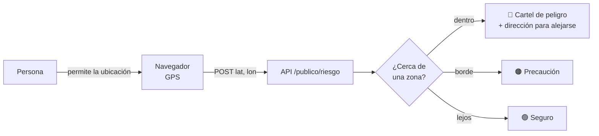
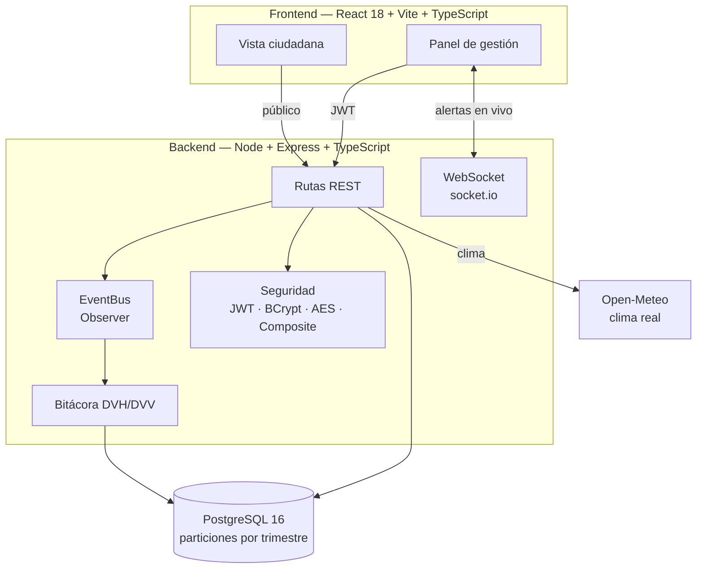

<div align="center">


**Plataforma web de orquestación logística y alerta temprana ante catástrofes climáticas para ciudades inteligentes**


[Documentación](docs/README.md) · [Cómo levantarlo](#cómo-levantarlo) · [Modo ciudadano](#modo-ciudadano) · [Arquitectura](#arquitectura) · [Equipo](#equipo)

</div>

**Proyecto:** Trabajo Integrador Final — Prácticas Profesionalizantes · Escuela Secundaria Técnica · Argentina · 2026
**Estado:** prototipo académico en desarrollo. No reemplaza a los organismos oficiales: ante una emergencia real llamá al **911**, **100** (bomberos) o **103** (Defensa Civil).

---

## Qué hace

| Para el personal de gestión | Para la ciudadanía |
|---|---|
| **Monitoreo en tiempo real** de sensores de agua, temperatura, viento y calidad del aire | **Clima real** y calidad del aire (Open-Meteo), sin crear una cuenta |
| **Alertas** con ciclo completo: reconocer, planificar evacuación y resolver | **Avisos** marcados como *REAL* o *SIMULADO* |
| **Evacuaciones** con estrategias de ruta intercambiables en ejecución | **Alerta por ubicación**: cartel de zona peligrosa y hacia dónde alejarse |
| **Motor de simulación** de crisis (inundación, incendio, viento, cortes de energía) | **Mapa** de zonas de riesgo y modo prueba |
| **Bitácora inmutable** con verificación criptográfica DVH/DVV | **Registro** con consentimientos legales y control de los propios datos |
| **Control de acceso** por familias y patentes (patrón Composite) | Rol `CIUDADANO` de solo lectura |

---

## Cómo levantarlo

Necesitás **Node 20 o superior** y **Docker Desktop** abierto.

### Windows (un solo paso)

```bat
arrancar.bat
```

El script reutiliza o crea el contenedor de PostgreSQL, aplica las migraciones, carga los datos iniciales, genera el `.env` con secretos aleatorios si falta, instala dependencias y abre el backend y el frontend.

Después entrá a **<http://localhost:5173>**.

| Rol | Usuario | Contraseña |
|---|---|---|
| Administrador de demostración | `admin` | `Admin2026!` |

> [!WARNING]
> Es un usuario de **demostración** que viene en los datos iniciales. Cambiá la contraseña o eliminá el usuario antes de exponer el sistema fuera de tu computadora.

`detener.bat` apaga los servidores.

### Manualmente

```bash
docker compose up postgres -d                        # base de datos en el puerto 5555
cd aegis-urban-backend  && npm install && node scripts/crear-env.js && npm run dev
cd aegis-urban-frontend && npm install && npm run dev
```

Las migraciones están en `aegis-urban-backend/database/migrations/` (001 a 012) y los datos de ejemplo en `database/seeds/`. Docker las aplica solo al crear un volumen vacío; en una base existente aplicalas en orden (el `arrancar.bat` se ocupa de 006 a 012).

### Comandos

| Dónde | Comando | Qué hace |
|---|---|---|
| backend | `npm run dev` | API con recarga automática en `:3001` |
| backend | `npm test` | Pruebas unitarias (47) |
| backend | `npm run build` | Compila a JavaScript |
| frontend | `npm run dev` | Web con Vite en `:5173` |
| frontend | `npm test` | Pruebas del frontend (3) |
| frontend | `npm run build` | Verifica tipos y genera el bundle |

---

## Modo ciudadano

Abrí **`/ciudadano`** (no pide cuenta) para ver el clima, los avisos y las zonas de riesgo.



- La ubicación es **opcional y revocable**. Las coordenadas exactas no se guardan.
- Las zonas de riesgo salen de las alertas de los sensores de las últimas 6 horas; el radio crece con la severidad.
- El **modo prueba** permite ubicarse dentro, cerca o lejos de una zona sin moverse. Para generar una zona, iniciá un escenario desde *Simulación*.
- El GPS del navegador requiere `localhost` o HTTPS.

### Registro y marco legal

Al crear una cuenta (`/registro`) hay que aceptar, con casillas sin marcar de antemano:

1. [Términos y Condiciones](aegis-urban-frontend/src/legal/textos.ts)
2. Política de Privacidad, según la **Ley 25.326** de Protección de los Datos Personales
3. La declaración de edad (18 años o autorización de un tutor)

El permiso de **ubicación** se pide aparte y es opcional. Cada consentimiento queda registrado con su versión, fecha e IP. La persona puede descargar sus datos y darse de baja (la cuenta se anonimiza).

> [!IMPORTANT]
> Los textos legales son una **base para el prototipo**. Un profesional debe revisarlos antes de un uso real con público. Detalle en el [Anexo E](docs/documento-funcional/06-anexos.md#anexo-e--marco-legal-y-consentimientos).

---

## Arquitectura



### Roles

| Familia | Acceso |
|---|---|
| `ADMIN_SISTEMA` | Todo el sistema, usuarios y familias |
| `OPERADOR_CRISIS` | Mapa, sensores, alertas y panel |
| `DEFENSA_CIVIL` | Reconocer y resolver alertas, evacuar, ejercicios simulados |
| `TRANSITO` | Consulta de mapa, sensores y alertas |
| `AUDITOR` | Consulta operativa y verificación de bitácora; sin cambios |
| `CIUDADANO` | Solo su vista pública y sus propios datos; ninguna pantalla de gestión |

### Patrones de diseño

| Patrón | Clase clave | Ubicación | Propósito |
|---|---|---|---|
| **Factory** | `SensorFactory` | `aegis-urban-backend/src/core/factory/` | Crear el sensor según su tipo |
| **Observer** | `EventBus` y handlers | `aegis-urban-backend/src/core/events/` | Propagar lecturas, alertas y bitácora |
| **Strategy** | `ContextoEvacuacion` | `aegis-urban-backend/src/core/strategies/` | Cambiar la estrategia de evacuación |
| **Composite** | `FamilyComposite` | `aegis-urban-backend/src/core/composite/` | Agrupar permisos en familias |

### Estructura del repositorio

```text
AEGIS-Urban/
├── aegis-urban-backend/
│   ├── database/migrations/    # Esquema SQL versionado (001–012)
│   ├── database/seeds/         # Datos iniciales y de ejemplo
│   ├── scripts/                # crear-env.js (genera el .env)
│   ├── src/
│   │   ├── core/               # Factory, Observer, Strategy, Composite, geo
│   │   ├── modules/            # auth, alertas, sensores, simulación, admin, public…
│   │   ├── security/           # BCrypt, AES, autorización por familia
│   │   └── integrity/          # Bitácora DVH/DVV
│   └── tests/
├── aegis-urban-frontend/
│   └── src/                    # pages, components, hooks, store, legal, services
├── docs/                       # Documento funcional por etapas, anexos e imágenes
├── docker-compose.yml
├── arrancar.bat                # Arranque en un paso (Windows)
└── detener.bat
```

---

## Sistema de diseño

Tema **cian neón + vidrio**: fondo negro azulado con resplandores y grilla tipo radar, tarjetas translúcidas y estados en neón. Los tokens están en [`aegis-urban-frontend/src/index.css`](aegis-urban-frontend/src/index.css).

| Uso | Color |
|---|---|
| Fondo | `#060A14` · `#0B1220` · `#16223A` |
| Identidad | Cian `#22E5FF` · Violeta `#8B5CF6` |
| Texto | `#F1F7FF` · secundario `#8FA3C0` |
| Estados | Peligro `#FF4D6D` · Advertencia `#FFB020` · Seguro `#19F5A0` |

Tipografías: **Inter** para la interfaz y **JetBrains Mono** para valores de sensores.

---

## Documentación

Toda la documentación se lee directamente en GitHub, por páginas:

**[docs/](docs/README.md)** — documento funcional por etapas (análisis, diseño, implementación y release), anexos con contratos de API, backlog y marco legal, y diagramas.

| Documento | Contenido |
|---|---|
| [Documento funcional](docs/documento-funcional/README.md) | Las cuatro etapas del ciclo de vida, con índice por apartado |
| [Arquitectura](docs/01-arquitectura.md) | Carpetas, modelo de datos y decisiones técnicas |
| [Análisis y diseño original](docs/02-analisis-diseno.md) | Casos de uso, diagramas y matriz de permisos |

---

## Equipo

| # | Rol | Responsabilidad principal |
|---|---|---|
| I1 | Product Owner y documentador QA | Carpeta de campo, criterios de aceptación, plan de pruebas |
| I2 | Desarrollo frontend | React, mapa de ciudad, UI de alertas, i18n |
| I3 | Desarrollo backend core | Node.js, patrones de diseño, API REST |
| I4 | Seguridad y base de datos | PostgreSQL, AES/BCrypt, DVH/DVV, backups |
| I5 | Integración full-stack y WebSockets | socket.io, integración, CI/CD, despliegue |

### Planificación de referencia

| Sprint | Fechas | Foco |
|---|---|---|
| 1 | 19/05 – 30/05/2026 | Fundamentos e infraestructura |
| 2 | 02/06 – 13/06/2026 | Seguridad, autenticación y DVH/DVV |
| 3 | 16/06 – 27/06/2026 | Patrones core y telemetría en tiempo real |
| 4 | 30/06 – 11/07/2026 | UI de ciudad y motor de simulación |
| 5 | 14/07 – 25/07/2026 | Pruebas, auditoría y entrega final |

---

<div align="center">

*AEGIS Urban — Advanced Emergency Geographic Intelligence System*
*Escuela Técnica Argentina — Prácticas Profesionalizantes 2026*

</div>
