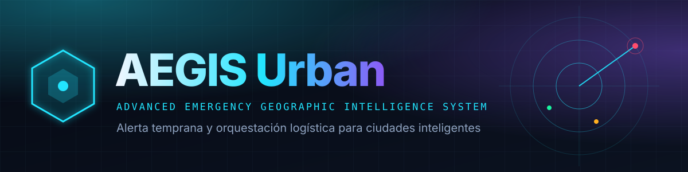

# Documentación de AEGIS Urban

AEGIS Urban es una plataforma de alerta temprana y apoyo a operaciones municipales ante amenazas climáticas. Reúne telemetría de sensores, alertas, mapa, simulación y planificación de evacuaciones, y ofrece a la ciudadanía una vista pública con clima real y aviso por ubicación.

> [!IMPORTANT]
> **Alcance del proyecto:** es un prototipo académico. No reemplaza a los organismos oficiales ni debe presentar lecturas de sensores o simulaciones como instrucciones oficiales de emergencia. Ante una emergencia real: **911**, **100** (bomberos) o **103** (Defensa Civil).

## Documento funcional

El documento funcional sigue el ciclo de vida del software, en etapas numeradas. Cada etapa es una página con navegación anterior/siguiente:

| # | Página | Qué tiene |
|---|---|---|
| 0 | [Portada y equipo](documento-funcional/00-portada.md) | Identificación del proyecto, integrantes, propósito y convenciones |
| 1 | [Introducción, resumen ejecutivo y alcance](documento-funcional/01-introduccion.md) | Contexto, objetivos, usuarios, alcance y límites |
| 2 | [Etapa 1 — Análisis y factibilidad](documento-funcional/02-etapa-1-analisis.md) | 1.1 Problema y objetivos · 1.2 Contexto y actores · 1.3 Fuentes de alertas · 1.4 Factibilidades y alcance |
| 3 | [Etapa 2 — Diseño y arquitectura](documento-funcional/03-etapa-2-diseno.md) | 2.1 Arquitectura · 2.2 Modelo de datos · 2.3 Requerimientos · 2.4 Roles y permisos · 2.5 Interfaz y experiencia ciudadana · 2.6 Seguridad y calidad |
| 4 | [Etapa 3 — Implementación y testing](documento-funcional/04-etapa-3-implementacion.md) | 3.1 Estructura · 3.2 Funcionalidades · 3.3 Pruebas y compilación · 3.4 Migraciones y puesta en marcha |
| 5 | [Etapa 4 — Release, operación y mantenimiento](documento-funcional/05-etapa-4-release.md) | 4.1 Release · 4.2 Aceptación · 4.3 Reversión · 4.4 Manuales · 4.5 Mantenimiento · 4.6 Anexos · 4.7 Cierre y trabajo futuro |
| 6 | [Anexos](documento-funcional/06-anexos.md) | A. Roles y alertas públicas · B. Contratos de API · C. Glosario · D. Backlog · E. Marco legal y consentimientos |

El índice completo, con cada apartado, está en [documento-funcional/README.md](documento-funcional/README.md). Los diagramas están en [documento-funcional/img/](documento-funcional/img/).

## Otros documentos

- [Arquitectura detallada](01-arquitectura.md): carpetas, modelo de datos y decisiones técnicas.
- [Análisis y diseño original](02-analisis-diseno.md): casos de uso, diagramas y matriz de permisos. Esta guía los ordena y añade trazabilidad funcional.
- [Marco legal y consentimientos](documento-funcional/06-anexos.md#anexo-e--marco-legal-y-consentimientos): cómo se aplica la Ley 25.326 en el registro, la ubicación y los derechos del titular.
- [Contratos de API](documento-funcional/06-anexos.md#anexo-b--contratos-de-api): endpoints de gestión, públicos y de cuenta.

## Datos y código

- [Backend y migraciones](../aegis-urban-backend/): API, lógica de dominio y esquema SQL versionado.
- [Frontend](../aegis-urban-frontend/): interfaz React por páginas y componentes.
- Las migraciones de `aegis-urban-backend/database/migrations/` son la fuente de verdad del esquema. Una migración aplicada no se edita: los cambios nuevos se agregan con un número nuevo.
- [README del proyecto](../README.md): requisitos, arranque local, variables y comandos.

## Convención de estado

Cada capacidad se marca como **implementada**, **parcial** o **propuesta** según los archivos presentes en este repositorio. Un requerimiento documentado no implica por sí solo que esté implementado ni validado.

[← Volver al proyecto](../README.md)
