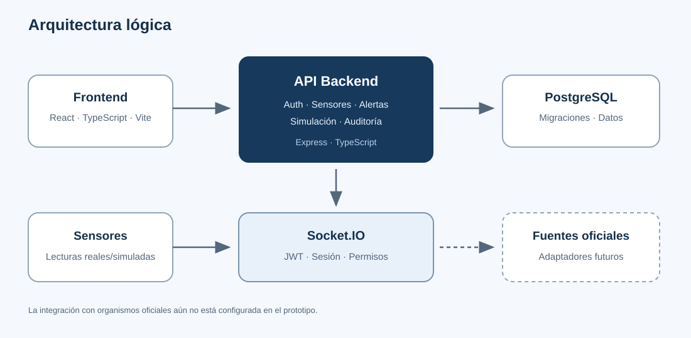
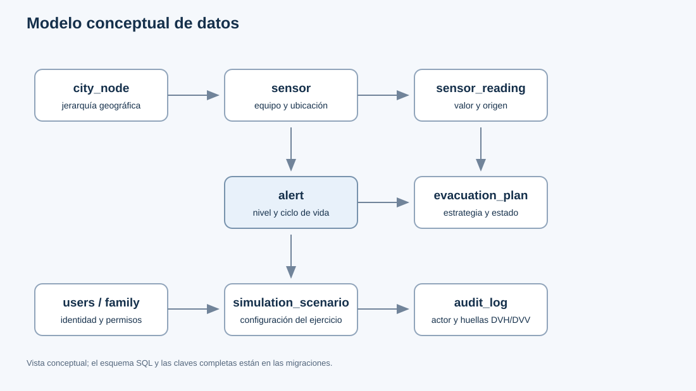
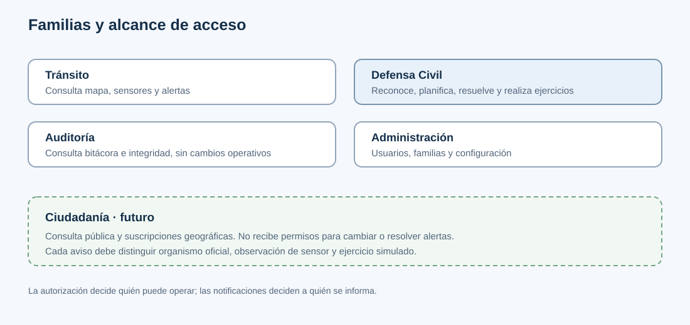

# Etapa 2 — Diseño y arquitectura

**En esta página:** arquitectura, modelo de datos, requerimientos, roles, interfaz y seguridad.

Con el problema y el alcance definidos, esta etapa describe cómo se organiza la solución y qué criterios guían su implementación.

## 2.1 Arquitectura

El frontend React, TypeScript y Vite consume una API Express con TypeScript. PostgreSQL conserva usuarios, sensores, lecturas, alertas, escenarios y auditoría. Socket.IO distribuye eventos a sesiones autenticadas y autorizadas. Docker Compose reúne los servicios de desarrollo.

*Figura 1. Intercambio entre interfaz, API, base de datos, fuentes y canal en vivo.*

## 2.2 Modelo de datos

Las migraciones de `aegis-urban-backend/database/migrations/` son la fuente de verdad del esquema. Las tablas principales son:

| Entidad | Datos principales | Relación |
|---|---|---|
| `users`, `family`, `patent` | identidad, estado, rol y permiso | controlan acceso a funciones |
| `city_node` | nombre, tipo, padre y geometría | Ciudad → Distrito → Zona → Bloque |
| `sensor_type` | tipo, unidad y umbrales | clasifica los sensores |
| `sensor` | serie, estado, coordenadas y nodo | pertenece a un tipo y un área |
| `sensor_reading` | valor, estado, origen y hora | pertenece a un sensor y se particiona por fecha |
| `alert` | nivel, tipo, texto, estado y responsables | se origina en un sensor |
| `evacuation_plan` | estrategia, ruta, alcance y estado | se asocia a una alerta |
| `simulation_scenario`, `simulation_event` | parámetros, estado, sensor y valor | registra ejercicios y sus lecturas |
| `audit_log`, `audit_log_control` | actor, acción y huellas DVH/DVV | conserva evidencia de cambios |

*Figura 2. Vista conceptual del modelo; las migraciones contienen las claves y restricciones completas.*

## 2.3 Requerimientos

| ID | Requerimiento | Estado en el prototipo |
|---|---|---|
| RF-01 | Autenticar usuarios y autorizar operaciones por familia | JWT, middleware API y permisos WebSocket implementados |
| RF-02 | Consultar estado, ubicación y última lectura de sensores | Implementado |
| RF-03 | Ubicar sensores y revisar su historial en el mapa | Implementado; filtros cartográficos adicionales pendientes |
| RF-04 | Filtrar alertas por zona, fecha, estado, severidad y texto, con paginación del servidor | Implementado en código; requiere migración y verificación en base local |
| RF-05 | Reconocer, escalar y resolver alertas con actor y fecha | Implementado para el flujo de alertas actual |
| RF-06 | Crear, iniciar y detener escenarios de ejercicio parametrizados | Implementado en código; requiere migración 010 y prueba operativa |
| RF-07 | Consultar bitácora y verificar integridad | Implementado; mejoras de consulta y exportación pendientes |
| RF-08 | Restringir datos y operaciones según familia | Implementado en API; pruebas unitarias por familias incorporadas |
| RF-09 | Informar estado del backend, base y canal de tiempo real | Implementado en el panel operativo |
| RF-10 | Distribuir avisos públicos oficiales por zona | Fuera del prototipo; requiere una fuente autorizada y una vista pública |

## 2.4 Roles y permisos

Los roles determinan quién puede ejecutar cambios dentro del sistema. Las notificaciones determinan a quién se avisa. La aplicación necesita ambos mecanismos.

| Familia | Acceso de referencia |
|---|---|
| Tránsito | Consulta de mapa, sensores y alertas |
| Defensa Civil | Consulta y acciones de respuesta; ejercicios simulados |
| Auditoría | Consulta operativa y verificación de bitácora; sin cambios operativos |
| Administración | Gestión de usuarios, familias y configuración |
| Ciudadanía (futuro) | Consulta pública sin cuenta obligatoria; suscripciones optativas por área |

*Figura 3. La ciudadanía recibe información pública; no adquiere permisos de operación.*

## 2.5 Diseño de interfaz y experiencia ciudadana

La aplicación operativa ofrece Panel, Mapa, Sensores, Alertas, Simulación y Administración. Debe mostrar severidad con texto e icono además de color, indicar cuándo se recibió la última lectura y ofrecer recuperación cuando falla una consulta.

La futura experiencia ciudadana debe abrir directamente el mapa/listado de avisos y permitir suscribirse por zona o tipo de amenaza. Cada aviso debe identificar autoridad emisora, vigencia, área afectada, fuente original y estado de actualización. Sensores AEGIS y ejercicios se etiquetan por separado; una simulación nunca se difunde como alerta pública.

## 2.6 Seguridad y calidad

- Validar paginación, fechas, zonas y configuración de escenarios en servidor.
- Ejecutar ejercicios sólo en sensores identificados como simulados.
- Verificar permisos en backend aunque la interfaz oculte acciones.
- Conservar la bitácora append-only para cambios relevantes.
- No presentar rutas de evacuación estimadas como instrucciones oficiales.
- En despliegues reales, usar TLS, secretos fuera del código y procedimientos de restauración probados.

[← Etapa 1 — Análisis y factibilidad](02-etapa-1-analisis.md) · [Índice](README.md) · [Etapa 3 — Implementación y testing →](04-etapa-3-implementacion.md)
